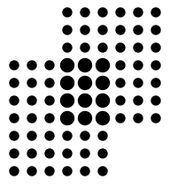

Weaving: from the documents to the website
==========================================

The documents are Markdown and read well on GitHub, but a literate program
is best read with its chunks linked to one another: each fragment says
where its chunk is used and where it continues, each reference is a link
to the chunk it names. `tools/weave.py` makes such a website out of the
documents, one page per document, with an index of the chunks. It reads the
documents with the same code as the tangler, so that the two never disagree
about what is program and what is prose, and leaves the prose to
[Python-Markdown](https://python-markdown.github.io) and the colours of the
code to [Pygments](https://pygments.org). These two packages are needed
only to weave, not to use opensheaf-py.

    # in tools/weave.py:
    #!/usr/bin/env python3
    """Weave the literate sources of opensheaf-py into a website.

        python3 tools/weave.py              write the pages into site/
        python3 tools/weave.py --out DIR    write them into DIR

    Needs the packages markdown and pygments (pip install markdown pygments).
    """
    import argparse
    import html
    import re
    import sys
    from pathlib import Path

    import markdown
    from pygments import highlight
    from pygments.formatters import HtmlFormatter
    from pygments.lexers import BashLexer, TextLexer, get_lexer_for_filename
    from pygments.util import ClassNotFound

    sys.path.insert(0, str(Path(__file__).resolve().parent))
    from tangle import FILE, REFERENCE, blocks, documents  # noqa: E402

    REPOSITORY = "https://github.com/opensheaf/opensheaf-py"

    <<pages, titles and anchors>>

    <<the web of chunks>>

    <<the page template filled>>

    <<the command line of the weaver>>

    if __name__ == "__main__":
        main()

Pages, titles and anchors
-------------------------

Each document becomes a page of the same name (`index.md` becomes the
front page, `index.html`). Its title is its first heading, written either
way Markdown allows. Every fragment gets an anchor made of the name of its
chunk and its number among the fragments of that chunk.

    # in pages, titles and anchors:
    def page_of(doc):
        return doc.stem + ".html"

    def title_of(doc):
        lines = doc.read_text(encoding="utf-8").split("\n")
        for i, line in enumerate(lines):
            if line.startswith("# "):
                return line[2:].strip()
            if line.strip() and i + 1 < len(lines) and re.match(r"^=+\s*$", lines[i + 1]):
                return line.strip()
        return doc.stem

    def slug(name):
        return re.sub(r"[^a-z0-9]+", "-", name.lower()).strip("-")

    def esc(text):
        return html.escape(text, quote=True)

The web of chunks
-----------------

The weaver needs more than the tangler: not only the fragments of each
chunk, but also, for each chunk, the fragments that refer to it, and the
file it ends up in, which decides how its code is coloured.

    # in the web of chunks:
    class Web:
        """The documents, their code blocks, and how the chunks refer to one another."""

        def __init__(self, docs, branch="main"):
            self.docs, self.branch = docs, branch
            self.blocks = {doc: blocks(doc) for doc in docs}
            self.fragments = {}
            for doc in docs:
                for block in self.blocks[doc]:
                    self.fragments.setdefault(block.name, []).append(block)
            <<number the fragments and find their users>>
            <<find the file of every chunk>>

        <<links to fragments and chunks>>

        <<rendering a code block>>

        <<rendering a document>>

        <<the index of chunks>>

Blocks are dataclasses, which compare by value; we index them by their
place, the document and first line, which is unique.

    # in number the fragments and find their users:
    self.anchor, self.number = {}, {}
    for name, fragments in self.fragments.items():
        for k, block in enumerate(fragments):
            self.anchor[block.doc, block.start] = f"{slug(name)}-{k + 1}"
            self.number[block.doc, block.start] = k
    self.users = {}
    for fragments in self.fragments.values():
        for block in fragments:
            for line in block.lines:
                ref = REFERENCE.match(line)
                if ref:
                    users = self.users.setdefault(ref.group(2), [])
                    if block.name not in [b.name for b in users]:
                        users.append(block)

A chunk is coloured as the file it is part of: we go down from every file
through the references, and each chunk keeps the first file that reaches
it.

    # in find the file of every chunk:
    self.file = {}
    for name in self.fragments:
        if FILE.match(name):
            todo = [name]
            while todo:
                chunk = todo.pop()
                if chunk in self.file or chunk not in self.fragments:
                    continue
                self.file[chunk] = name
                todo.extend(ref.group(2) for block in self.fragments[chunk]
                            for line in block.lines for ref in [REFERENCE.match(line)] if ref)

A link to a fragment is an anchor on the same page or on another; a link
to a chunk goes to its first fragment, and a reference to a chunk that is
not defined is shown, in red, rather than lost. Files without a type known
to Pygments are the shell scripts in `tools/`.

    # in links to fragments and chunks:
    def href(self, block, here):
        anchor = self.anchor[block.doc, block.start]
        return f"#{anchor}" if block.doc == here else f"{page_of(block.doc)}#{anchor}"

    def chunk_link(self, name, here, css="ref"):
        if name not in self.fragments:
            return f'⟨{esc(name)}⟩'
        return f'<a class="{css}" href="{self.href(self.fragments[name][0], here)}">⟨{esc(name)}⟩</a>'

    def lexer(self, name):
        file = self.file.get(name, "")
        try:
            return get_lexer_for_filename(file)
        except ClassNotFound:
            return BashLexer() if file.startswith("tools/") else TextLexer()

Rendering a code block
----------------------

The code is coloured by Pygments, which knows nothing of references: we
replace each reference by a word that is an identifier in every language,
colour, and replace the word, with whatever span Pygments put around it,
by a link to the chunk.

    # in rendering a code block:
    def code_html(self, block, here):
        lines, refs = [], []
        for line in block.lines:
            ref = REFERENCE.match(line)
            if ref:
                lines.append(f"{ref.group(1)}CHUNKREF{len(refs)}X")
                refs.append(ref.group(2))
            else:
                lines.append(line)
        code = highlight("\n".join(lines) + "\n", self.lexer(block.name), HtmlFormatter(nowrap=True))
        for k, name in enumerate(refs):
            link = self.chunk_link(name, here)
            code = re.sub(rf'CHUNKREF{k}X|CHUNKREF{k}X', lambda m: link, code)
        return code

Above the code stands the name of the chunk, followed by `≡` for its first
fragment and `+≡` for the others, as in Norman Ramsey's noweb; below it,
where the chunk is used, where it went on before and goes on after, and,
for a file, a link to the file in the repository.

    # in rendering a code block:
    def block_html(self, block, here):
        name, fragments = block.name, self.fragments[block.name]
        k, anchor = self.number[block.doc, block.start], self.anchor[block.doc, block.start]
        title = f"<code>{esc(name)}</code>" if FILE.match(name) else f"⟨{esc(name)}⟩"
        notes = []
        if k > 0:
            notes.append(f'continues <a href="{self.href(fragments[k - 1], here)}">the fragment before</a>')
        if k + 1 < len(fragments):
            notes.append(f'continued <a href="{self.href(fragments[k + 1], here)}">further on</a>')
        users = self.users.get(name, [])
        if users:
            notes.append("used in " + ", ".join(
                f'<a href="{self.href(b, here)}">⟨{esc(b.name)}⟩</a>' for b in users))
        if FILE.match(name) and k == 0:
            notes.append(f'<a href="{REPOSITORY}/blob/{self.branch}/{name}">the file in the repository</a>')
        return (f'
'
                f'
<a href="#{anchor}">{title}</a> {"+≡" if k else "≡"}
'
                f'<pre class="code">{self.code_html(block, here)}</pre>'
                + (f'
{"; ".join(notes)}.
' if notes else "")
                + "
")

Rendering a document
--------------------

The code blocks are taken out of the document and replaced by placeholders,
each a paragraph of its own; Markdown renders the rest; the placeholders
are then replaced by the rendered blocks. Links between documents
(`[tangling](90-tangle.md)`) are made links between pages, and GitHub's
alerts (`> [!WARNING]`) boxes.

    # in rendering a document:
    def document_html(self, doc):
        lines = doc.read_text(encoding="utf-8").split("\n")
        parts, last = [], 0
        for k, block in enumerate(self.blocks[doc]):
            parts += lines[last:block.start] + ["", f"CHUNKBLOCK{k}X", ""]
            last = block.end
        parts += lines[last:]
        body = markdown.markdown("\n".join(parts), extensions=["tables", "fenced_code", "codehilite", "toc"],
                                 extension_configs={"codehilite": {"guess_lang": False, "css_class": "code"}})
        for k, block in enumerate(self.blocks[doc]):
            body = body.replace(f"
CHUNKBLOCK{k}X
", self.block_html(block, doc))
        body = re.sub(r'href="([\w.-]+)\.md(#[^"]*)?"',
                      lambda m: f'href="{m.group(1)}.html{m.group(2) or ""}"', body)
        return re.sub(r"<blockquote>\s*
\[!(WARNING|NOTE|IMPORTANT|TIP|CAUTION)\]\s*",
                      lambda m: f'<blockquote class="alert {m.group(1).lower()}">
', body)

The index of chunks
-------------------

The last page lists the files, each with the document that makes it, and
every chunk in alphabetical order, with its fragments and its users.

    # in the index of chunks:
    def index_html(self):
        here = Path("chunks.md")
        files = [n for n in self.fragments if FILE.match(n)]
        rows = "".join(
            f'<tr><td><a href="{self.href(self.fragments[n][0], here)}"><code>{esc(n)}</code></a></td>'
            f'<td>{esc(title_of(self.fragments[n][0].doc))}</td></tr>' for n in files)
        items = []
        for name in sorted((n for n in self.fragments if not FILE.match(n)), key=str.lower):
            fragments = ", ".join(f'<a href="{self.href(b, here)}">{k + 1}</a>'
                                  for k, b in enumerate(self.fragments[name]))
            users = ", ".join(f'<a href="{self.href(b, here)}">⟨{esc(b.name)}⟩</a>'
                              for b in self.users.get(name, []))
            items.append(f"<li>{self.chunk_link(name, here)}: {fragments}"
                         + (f"; used in {users}" if users else "") + "</li>")
        return ("<h1>Files and chunks</h1><h2>Files</h2>"
                f"<table><tr><td>File</td><td>Made in</td></tr>{rows}</table>"
                f'<h2>Chunks</h2><ul class="chunks">{"".join(items)}</ul>')

The page template filled
------------------------

Every page has the same frame, a template with placeholders in double
braces: a header, the list of chapters at the side, and links to the
chapters before and after at the end. The title of the front page has the
OpenSheaf symbol on its left, the dot mark of the logo without its
lettering, as tall as the letters; so does the name in the header bar of
every page.

    # in the page template filled:
    SYMBOL = ''

    def fill(template, **values):
        return re.sub(r"\{\{(\w+)\}\}", lambda m: values[m.group(1)], template)

    def write_pages(web, out, template):
        pages = [(page_of(d), title_of(d)) for d in web.docs] + [("chunks.html", "Files and chunks")]
        for k, (page, title) in enumerate(pages):
            body = web.index_html() if page == "chunks.html" else web.document_html(web.docs[k])
            if page == "index.html":
                body = re.sub(r"(<h1[^>]*>)", lambda m: m.group(1) + SYMBOL, body, count=1)
            nav = "".join(f'<li{" class=current" if p == page else ""}><a href="{p}">{esc(t)}</a></li>'
                          for p, t in pages)
            turn = ""
            if k > 0:
                turn += f'<a class="prev" href="{pages[k - 1][0]}">← {esc(pages[k - 1][1])}</a>'
            if k + 1 < len(pages):
                turn += f'<a class="next" href="{pages[k + 1][0]}">{esc(pages[k + 1][1])} →</a>'
            (out / page).write_text(fill(template, title=esc(title), nav=f"<ol>{nav}</ol>", body=body,
                                         turn=turn, repository=REPOSITORY), encoding="utf-8")

The weaver writes the pages, the stylesheet and the symbol into a folder,
`site/` by default, which is not kept in the repository; the template, the
stylesheet and the symbol (a copy of `resources/brand/opensheaf-symbol.svg`
of the specification's repository) sit next to the weaver. The symbol is not
under the GPL of this program: it is licensed under CC BY 4.0, and its use
as a mark follows the OpenSheaf
[trademark policy](https://github.com/opensheaf/opensheaf.github.io/blob/main/TRADEMARKS.md).

    # in the command line of the weaver:
    def main(argv=None):
        p = argparse.ArgumentParser(description=__doc__.split("\n")[0])
        p.add_argument("documents", nargs="*", type=Path,
                       help="the literate documents (default: literate/*.md)")
        p.add_argument("--out", type=Path, default=Path("site"), help="where to write the website")
        p.add_argument("--branch", default="main", help="the branch the links to files point to")
        args = p.parse_args(argv)
        tools = Path(__file__).resolve().parent
        web = Web(args.documents or documents(), args.branch)
        args.out.mkdir(parents=True, exist_ok=True)
        write_pages(web, args.out, (tools / "weave.html").read_text(encoding="utf-8"))
        <<write the stylesheet>>
        (args.out / "opensheaf-symbol.svg").write_bytes((tools / "opensheaf-symbol.svg").read_bytes())
        print(f"wove {len(web.docs) + 1} pages into {args.out}")

The stylesheet is ours followed by the colours of Pygments, a light style
and, for readers who prefer it, a dark one.

    # in write the stylesheet:
    light = HtmlFormatter(style="default").get_style_defs(".code")
    dark = HtmlFormatter(style="github-dark").get_style_defs(".code")
    css = (tools / "weave.css").read_text(encoding="utf-8")
    (args.out / "style.css").write_text(
        f"{light}\n@media (prefers-color-scheme: dark) {{\n{dark}\n}}\n{css}", encoding="utf-8")

The template and the stylesheet
-------------------------------

    <!-- in tools/weave.html: -->
    <!DOCTYPE html>
    <html lang="en">
    <head>
    <meta charset="utf-8">
    <meta name="viewport" content="width=device-width, initial-scale=1">
    <title>{{title}} · opensheaf-py</title>
    <link rel="stylesheet" href="style.css">
    </head>
    <body>
    <header class="site">
      <a class="home" href="index.html">opensheaf-py</a>
      the tools of <a href="https://opensheaf.org">OpenSheaf</a>, a literate program
      <a href="chunks.html">chunks</a> · <a href="{{repository}}">source</a>
    </header>
    

    <nav class="chapters">{{nav}}</nav>
    <main>
    {{body}}
    <nav class="turn">{{turn}}</nav>
    </main>
    

    </body>
    </html>

The colours are defined once, as variables, and again for a dark
background; the code is set a little smaller than the prose, with its
chunk name above it as a caption. Chunk names, above the code and in it, are
set in the italic of the text face, a little larger than the code, since a
serif italic looks smaller than the monospaced letters around it.

    /* in tools/weave.css: */
    :root {
      --text: #1f2328; --muted: #59636e; --bg: #fdfdfb; --panel: #f4f3ee;
      --rule: #d8d6cc; --accent: #8a2b1e; --code-bg: #f7f6f1; --link: #1a5fb4;
    }
    @media (prefers-color-scheme: dark) {
      :root {
        --text: #e6e3da; --muted: #a29f95; --bg: #18191b; --panel: #222326;
        --rule: #3a3b3f; --accent: #e7a08f; --code-bg: #0d1117; --link: #8cb4f0;
      }
    }
    * { box-sizing: border-box; }
    body { margin: 0; background: var(--bg); color: var(--text);
      font: 17px/1.55 Charter, "Bitstream Charter", "Iowan Old Style", Georgia, serif; }
    a { color: var(--link); text-decoration: none; }
    a:hover { text-decoration: underline; }
    header.site { display: flex; flex-wrap: wrap; gap: .4em 1em; align-items: baseline;
      padding: .7em 16px; border-bottom: 1px solid var(--rule); background: var(--panel);
      font-family: system-ui, sans-serif; font-size: 14px; color: var(--muted); }
    header.site .home { font-weight: 600; color: var(--accent); font-size: 16px; }
    header.site .links { margin-left: auto; }
    .layout { display: flex; max-width: 74rem; margin: 0 auto; }
    nav.chapters { flex: 0 0 15rem; padding: 1.5em 1em; font: 14px/1.4 system-ui, sans-serif;
      position: sticky; top: 0; align-self: flex-start; max-height: 100vh; overflow-y: auto; }
    nav.chapters ol { margin: 0; padding-left: 1.4em; }
    nav.chapters li { margin: .35em 0; }
    nav.chapters li.current a { color: var(--accent); font-weight: 600; }
    main { flex: 1; min-width: 0; max-width: 48rem; padding: 1em 16px 4em; }
    h1, h2, h3 { color: var(--accent); line-height: 1.25; font-weight: 600; }
    h1 { font-size: 1.8em; }
    h2 { font-size: 1.35em; margin-top: 1.8em; }
    h3 { font-size: 1.1em; margin-top: 1.5em; }
    code { font: .86em/1.4 ui-monospace, "SF Mono", Menlo, Consolas, monospace; }
    pre { overflow-x: auto; }
    .chunk { margin: 1.2em 0; }
    .chunk-name { font: italic 16px/1.4 Charter, Georgia, serif; color: var(--muted); }
    .chunk-name a { color: var(--accent); }
    pre.code, div.code pre { margin: .25em 0; padding: .6em .8em; background: var(--code-bg);
      border-left: 3px solid var(--rule); font: 13.5px/1.45 ui-monospace, "SF Mono", Menlo, Consolas, monospace; }
    div.code { background: none; }
    .code a.ref { color: var(--accent); font-family: Charter, Georgia, serif; font-style: italic;
      font-size: 1.12em; }
    .undefined { color: #c01c28; font-style: italic; }
    .chunk-notes { font: 14px/1.45 system-ui, sans-serif; color: var(--muted); }
    table { border-collapse: collapse; margin: 1em 0; font-size: .95em; }
    td { border-bottom: 1px solid var(--rule); padding: .3em .7em .3em 0; vertical-align: top; }
    tr:first-child td { font-weight: 600; }
    blockquote { margin: 1em 0; padding: .2em 1em; border-left: 3px solid var(--rule); color: var(--muted); }
    blockquote.alert { border-left: 4px solid #bf8700; background: var(--panel); color: var(--text); }
    blockquote.alert > p:first-child::before { content: "Warning. "; font-weight: 600; }
    blockquote.note > p:first-child::before { content: "Note. "; }
    ul.chunks { padding-left: 1.2em; }
    h1 img.symbol { height: 1.1em; width: auto; vertical-align: -0.12em; margin-right: 0.35em; }
    header.site img.symbol { height: 1.15em; width: auto; vertical-align: -0.2em; margin-right: 0.4em; }
    @media (prefers-color-scheme: dark) { img.symbol { filter: invert(1); } }
    nav.turn { display: flex; justify-content: space-between; gap: 1em; margin-top: 3em;
      padding-top: 1em; border-top: 1px solid var(--rule); font: 14px system-ui, sans-serif; }
    nav.turn .next { margin-left: auto; text-align: right; }
    @media (max-width: 52rem) {
      .layout { display: block; }
      nav.chapters { position: static; max-height: none; border-bottom: 1px solid var(--rule); }
    }
